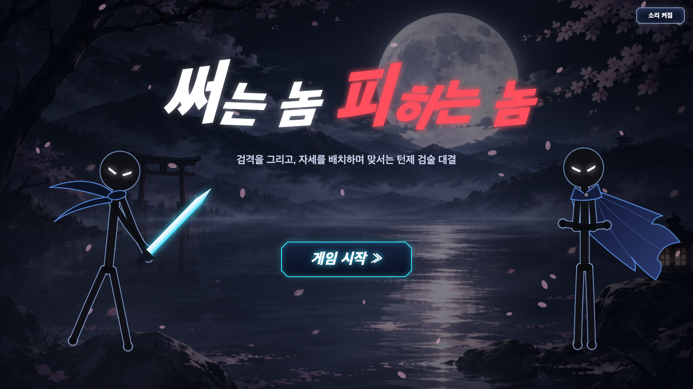

# Stickman Sword Duel (써는 놈 피하는 놈)



마우스로 검격의 궤적을 직접 그리고, 졸라맨의 몸을 움직여 상대의 공격을 피하는 턴제 검술 게임입니다. 10단계의 졸라맨 검객을 차례로 쓰러뜨리는 것이 목표이고, 5단계와 10단계에는 보스가 나옵니다.

**플레이:** [saaskr 게임에서 바로 하기](https://game.saaskr.com/games/%EC%8D%A8%EB%8A%94-%EB%86%88-%ED%94%BC%ED%95%98%EB%8A%94-%EB%86%88)

## 조작 (PC 전용)
- 마우스 드래그: 검격 그리기, 신체 관절 이동
- 머리 위 회전 버튼 드래그: 몸 기울이기, 뒤집기
- 클릭: 스킬 활성화, 완료
- 공격 턴과 방어 턴이 번갈아 진행됩니다.

## 특징
- 길이가 제한된 검격을 직접 그리는 공격
- 머리, 몸, 팔, 다리를 직접 움직이는 방어
- 단계마다 달라지는 적의 체형과 공격 패턴
- 고유 스킬을 가진 검 10종

## 실행
```bash
npm install
npm run dev     # 개발 서버
npm run build   # 타입 검사 + 단일 HTML 빌드
```

## 구조
- `src/logic`: 전투, AI, 포즈, 검, 스킬, 스테이지
- `src/render`: 캔버스 렌더링과 이펙트
- `docs`: 게임 명세, 캐릭터 디자인, UI 디자인

ChatGPT 등 AI 도구를 활용해 제작했습니다.

## 결과 업데이트

성적·순위·평가 결과는 아직 발표 전이며, 확정되는 대로 업데이트할 예정입니다.
